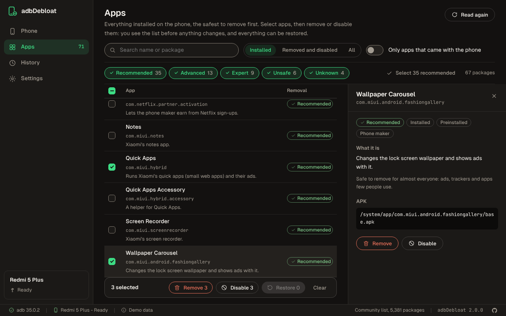
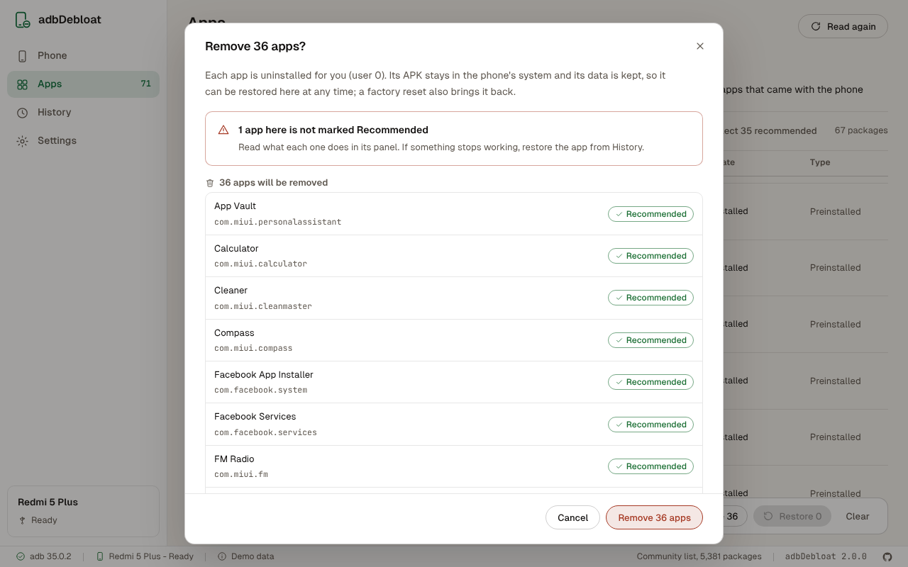
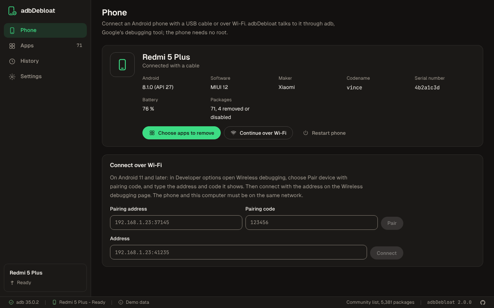

# adbDebloat


Remove the apps your Android phone came with, safely and reversibly.

adbDebloat is a Windows app that connects to an Android phone through adb, shows every package on
it with what it does and how safe it is to remove, and removes, disables or restores the ones you
pick. The phone needs no root.

<br clear="left">

> **Not fully tested yet.** Version 2.0.0 is tested against a simulated phone, and on GitHub's
> Windows runners it downloads Google's real adb and runs it, but it has not been used on a real
> phone yet. Start with a few apps marked Recommended, and check the phone before removing more.



## What it does

- **Connects the easy way.** By USB cable, or over Wi-Fi with a pairing code on Android 11 and
  later; a phone on a cable can also be switched to Wi-Fi with one button. No adb on the computer?
  adbDebloat downloads Google's platform-tools into its own folder.
- **Says what each package is.** A name people recognise, a description, and a safety level:
  Recommended, Advanced, Expert or Unsafe, from adbDebloat's own list of common apps and the
  community list of [Universal Android Debloater Next Generation](https://github.com/Universal-Debloater-Alliance/universal-android-debloater-next-generation)
  (several thousand packages). The safest to remove come first, and one button selects all the
  Recommended ones.
- **Shows the list before anything changes.** Removing, disabling and restoring always go through a
  review that lists what will change, what is left alone and why, and warns about anything not
  marked Recommended. Then it shows each app's result as it comes in.
- **Keeps the phone working.** It never removes or disables the core of Android, packages marked
  Unsafe, the home screen in use or the keyboard in use. Packages marked Expert need expert mode,
  which asks first. The backend checks these rules again before each command.
- **Undoes.** Every batch is kept in History, and Undo restores what it removed or disabled.
- English and Turkish, light and dark theme.



## Download

You need Windows 10 or 11. No administrator rights are needed.

1. Download `adbDebloat_<version>_x64-setup.exe` (or the `.msi`) from
   [Releases](https://github.com/bugragungoz/adbDebloat/releases).
2. Run it. The installer is not signed, so Windows SmartScreen may warn about it first: choose
   **More info**, then **Run anyway**.

Every build on the [Actions](https://github.com/bugragungoz/adbDebloat/actions) page also has both
installers attached as an artifact.

## Use

1. **Phone.** Turn on USB debugging on the phone (the page lists the steps; on Xiaomi, Developer
   options are under Additional settings), connect it and allow this computer when the phone asks.
2. **Apps.** Filter by safety level, search, or choose **Select recommended**. Click an app to read
   what it does. Choose **Remove**, **Disable** or **Restore** for the selection, read the review,
   and start.
3. **History.** If something stops working, open the batch and choose **Undo**, or find the app
   under **Removed and disabled** on the Apps page and restore it alone.



## What removing does

Without root, nothing can be deleted from the phone's system partition. adbDebloat uses what adb
allows for the main user (user 0):

| Action | Command | What happens |
|---|---|---|
| Remove | `pm uninstall -k --user 0 <package>` | The app is uninstalled for you; its APK stays in the system and its data is kept. |
| Disable | `pm disable-user --user 0 <package>` | The app stays installed but never runs, and its icon disappears. |
| Restore | `pm install-existing --user 0 <package>` or `pm enable --user 0 <package>` | The app comes back as it was. |

So every change can be undone, and a factory reset brings every removed system app back. Removing
does not free the space the APK takes in the system partition; it stops the app from running,
showing ads and collecting data. Some makers, Xiaomi among them, do not let adb disable their own
apps; remove those instead.

Version 1 of adbDebloat was a PowerShell script (still in the history, at commit `2a74ce1`). Its
"Permanent Remove" ran `pm uninstall` without `--user`, which fails for system apps without root
and deletes the data of apps you installed, and its "Danger Zone" offered to disable System UI and
Settings, which can stop a phone from starting. Version 2 replaces it.

## Where things are kept

- `%LOCALAPPDATA%\com.bugragungoz.adbdebloat`: the history (`history.json`), the downloaded
  community list and the downloaded platform-tools.
- `%APPDATA%\com.bugragungoz.adbdebloat\settings.json`: the settings.

adbDebloat goes online only to download platform-tools from Google (when you ask) and the community
list from GitHub (when allowed in Settings, at most once a week).

## Build it yourself

You need [Node.js](https://nodejs.org) 22, [Rust](https://rustup.rs) and, on Windows, the
[Tauri prerequisites](https://tauri.app/start/prerequisites/).

```bash
npm ci                 # install
npm run dev            # the app, with live reload
npm run dev:web        # the interface alone in a browser, with a simulated phone
npm run verify         # versions, locales, lint, colors, types and unit tests
cargo test --workspace # the Rust core (against a simulated phone) and the shell
npm run test:ui        # the built interface in Chromium
npm run shots          # the screenshots above
npm run build          # the installers (on Windows)
```

`cargo test -p adb-core --test network -- --include-ignored` also downloads the community list and
platform-tools and runs adb; CI runs it on Windows.

The project is a Rust core that knows adb and Android (`crates/adb-core`), a
[Tauri](https://tauri.app) shell (`src-tauri`) and a [Preact](https://preactjs.com) interface on
the Bugra design system (`src`, see [docs/design/ADDED.md](docs/design/ADDED.md)).

## Credits

- The community package list is maintained by
  [Universal Android Debloater Next Generation](https://github.com/Universal-Debloater-Alliance/universal-android-debloater-next-generation)
  under GPL-3.0. adbDebloat downloads it at run time and does not include it. If you want a
  cross-platform tool with more options, that project is the one to use.
- adb comes from Google's [platform-tools](https://developer.android.com/tools/releases/platform-tools),
  downloaded under Google's terms and not included either.
- [Geist](https://vercel.com/font) and [JetBrains Mono](https://www.jetbrains.com/lp/mono/), both
  under the SIL Open Font License. The GitHub mark is from
  [Primer Octicons](https://github.com/primer/octicons) (MIT).

## License

[MIT](LICENSE)

The first version was developed with assistance from an AI model: Claude Sonnet.

It was later rebuilt with Claude Opus 5.5.
